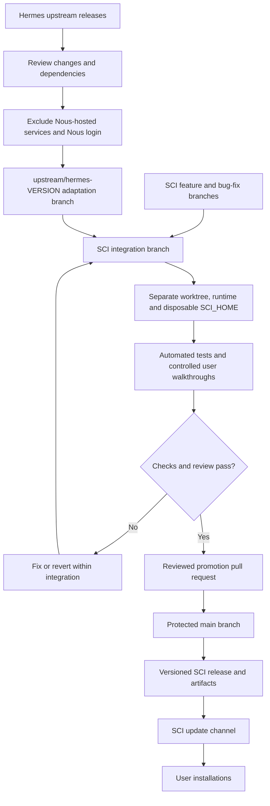

# Agent Scientist: Upstream Integration and Release Architecture

**Status:** Proposed workflow. This document does not create branches, configure GitHub protection, or change installations.

**Purpose:** Adopt useful Hermes improvements and develop SCI features without exposing the stable application to experimental changes.

## 1. Architecture



Plain-text overview for Markdown readers without Mermaid support:

```text
Hermes release                         SCI feature / bug fix
      |                                         |
Review, exclude Nous services, adapt             |
      +--------------------+--------------------+
                           |
                     INTEGRATION
             Separate checkout and test state
                           |
                    Test and review
                    /             \
                 Fail             Pass
                  |                |
          Fix/revert here     Promotion PR
                                   |
                              PROTECTED MAIN
                                   |
                            Tagged SCI release
                                   |
                             SCI user updates
```

## 2. Branch responsibilities

| Branch | Responsibility | May ship directly to users? |
|---|---|---|
| `main` | Approved, tested SCI code; source of releases | Only through the approved release process |
| `integration` | Combine and test candidate changes | No |
| `feature/<name>` | Develop one SCI feature | No |
| `fix/<name>` | Repair one defect | No |
| `upstream/hermes-<version>` | Adapt a reviewed upstream batch to SCI | No |

All SCI code changes—including our own features and upstream updates—pass through integration before promotion. Develop individual changes on focused branches rather than mixing unrelated edits directly into integration. Urgent fixes follow the same process with a smaller change set.

Create candidate branches from the current approved baseline. Keep integration synchronized with `main` and test the exact candidate that will be promoted. If the merge result differs from the tested candidate, rerun the relevant checks before releasing.

Do not include unfinished features in a promotion. Revert or separate them first. Do not switch the checkout serving the stable application onto an experimental branch.

## 3. Repository ownership and upstream tracking

- `origin` remains the Boltzmann Labs Agent Scientist repository.
- A maintainer checkout may have an `upstream` remote for the original Hermes repository. This is a development input, not the SCI update destination.
- Record the original Hermes baseline and each subsequently reviewed upstream revision. Extensive renaming and SCI's fresh history mean an ordinary merge may not reliably identify the changes we need.
- Integrate deliberate patches or reviewed merges; do not replace SCI's tree with the upstream tree.
- Preserve applicable licenses, copyright notices and contributor attribution when incorporating external code.
- Keep a short integration record: upstream revision, included changes, excluded changes, adaptations, tests and unresolved issues.

Upstream monitoring may be manual or produce a private report. It must not automatically create public issues, bot pull requests, commits or releases without a separate decision to enable that behavior.

## 4. What we import—and what we exclude

Candidate improvements include agent execution, context management, memory, skills, delegation, compatible plugins, MCP support, terminal/browser functionality, interfaces, performance and security fixes.

**Exclude Nous-hosted services and Nous login.** If a feature combines standalone functionality with a Nous dependency, review whether the standalone part can operate cleanly without that service. Do not claim that copying client code reproduces a hosted backend.

Preserve SCI's branding, launchers, paths, model authentication, scientific integrations and release channel. A plugin still requires compatibility and dependency review; being a plugin does not make installation automatically safe or compatible.

## 5. Environment isolation

A Git branch separates code history. It does not isolate processes, credentials, databases or remote side effects.

| Resource | Stable environment | Integration environment |
|---|---|---|
| Checkout | Stable SCI checkout/release | Separate Git worktree or clone |
| Python/runtime | Stable managed runtime | Separate managed test runtime |
| Application state | Existing user state | Disposable `SCI_HOME` |
| Runtime files | Stable runtime directory | Separate `SCI_RUNTIME_DIR` |
| Profiles and sessions | Real user profiles and conversations | Temporary fixtures, including A → B → A tests |
| Credentials | Production credentials | Controlled authentication responses or dedicated test credentials |
| Services/jobs | Normal user activity | Fixtures and approved test endpoints; no automatic production jobs |

Use SCI's package-management infrastructure to prepare test dependencies. Do not mutate the stable runtime during integration. Tests of home-anchored profile paths must also isolate the home directory; setting `SCI_HOME` alone does not cover every profile-management path.

A worktree shares Git metadata with its parent repository. It separates files, not operating-system permissions. Use a container or another suitable sandbox when actual execution isolation is required.

## 6. Protecting main

Configure GitHub branch protection or a ruleset to:

1. Require a pull request before changing `main`.
2. Require designated CI checks and review approval.
3. Require checks against the current merge candidate, using an up-to-date branch or merge queue where available.
4. Block force pushes and deletion of `main`.
5. Restrict administrative/bot bypasses and direct-push permissions.

These controls must be configured and verified in GitHub; documenting them does not enforce them. Release workflows must publish only approved commits/tags, never integration builds to the production update channel.

## 7. Validation gates

Use `scripts/run_tests.sh` for Python tests, plus the repository's appropriate frontend, packaging and platform checks for affected areas.

| Gate | Evidence required |
|---|---|
| Upstream review | Dependencies, service requirements, compatibility and license changes understood |
| Feature verification | New behavior works; failures and cancellation have clear outcomes |
| Scientific integrations | Boltzmann authorization and selected capabilities remain enforced; MCP permissions preserved |
| Profile isolation | Main → A → B → A preserves separate settings, service credentials, sessions and workspaces |
| Shared model authentication | Supported shared LLM access works without unintended credential copying or provider switching |
| Conversations | Activation/resume work; existing conversation prompts remain byte-stable except supported compression |
| Omics and specialists | Existing foundation and applicable specialist permission boundaries remain intact |
| Installation and update | Fresh install and upgrade paths work with temporary state; relevant artifacts build |
| User walkthrough | Exercise affected CLI/desktop flows with controlled services and fixture inputs |

Select tests according to the change's impact, then perform the release checks required for the supported platforms. A Linux test run is not evidence that Windows or macOS behavior works.

Report passes, failures, skips and untested paths honestly. Green tests reduce risk; they do not prove the absence of every regression or establish scientific correctness.

## 8. Release and recovery

After approval, promote the tested candidate to `main`, run the required checks, and create a SCI release using the agreed `v1.M.m.p` version format. SCI's updater consumes SCI releases—not Hermes releases directly.

Retain a known-good release and its artifacts. Before shipping state migrations, review compatibility, backup and recovery procedures. Rolling code back does not automatically undo a database migration, credential change, installation or submitted remote job.

If integration fails, fix or revert the candidate there. Stable `main` and user installations remain unchanged, provided tests were isolated and no promotion occurred. If a defect escapes into a release, stop further rollout where possible and issue a reviewed fix or compatible rollback.

## 9. Example: adopting a Hermes subagent improvement

**Hypothetical update:** Hermes improves cancellation and progress reporting for delegated agents. We want that benefit without breaking SCI's scientific profiles and specialist permissions.

1. **Review:** Identify the upstream commits and dependencies. Exclude any unrelated Nous-hosted integration.
2. **Adapt:** Create `upstream/hermes-delegation-update`. Apply the relevant changes using SCI's module names and configuration paths. Preserve SCI's permission checks and ownership rules.
3. **Integrate:** Bring the reviewed adaptation into `integration`, in a separate worktree and disposable test environment.
4. **Test:** Run a fixture specialist in profile A, cancel it, and confirm its owned work stops. Verify profile B cannot control A's run, an unauthorized tool remains unavailable, and the parent conversation's cached prompt is unchanged.
5. **Handle a regression:** Suppose the upstream change bypasses SCI's selected-tool allowlist. The test fails. Keep the change out of `main`; fix or revert it within the candidate branch and integration. Existing users continue using the approved SCI release.
6. **Retest and approve:** After the permission regression is fixed, rerun the relevant tests and controlled terminal walkthrough. Record the exact tested commit and open the promotion PR.
7. **Release:** Merge only after required checks and review. Publish the next appropriate SCI version. Users receive the improvement through SCI's updater.

**Result:** SCI gains the upstream improvement while retaining its scientific controls. The failed intermediate implementation never becomes a user release.

## 10. Implementation checklist

- [ ] Establish and record the upstream baseline.
- [ ] Configure maintainer upstream tracking.
- [ ] Create integration and focused candidate branches.
- [ ] Prepare a separate worktree, managed runtime and disposable test state.
- [ ] Configure and verify main-branch protection.
- [ ] Define required CI and release checks.
- [ ] Confirm production update workflows exclude integration artifacts.
- [ ] Trial the process with one small upstream improvement.
- [ ] Record test results, release approval and recovery instructions.

No item above is marked complete solely because this document exists.
